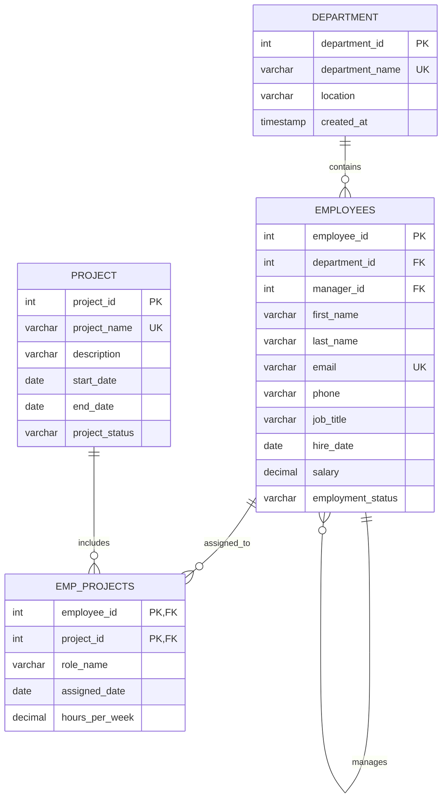

# Employee Management System ER Diagram

## Relationships

- One `department` has many `employees`.
- One employee may manage many employees; `manager_id` is a self-referencing foreign key.
- Employees and projects have a many-to-many relationship through `emp_projects`.
- The composite primary key `(employee_id, project_id)` prevents duplicate assignments.

## Primary keys

| Table | Primary key |
|---|---|
| `department` | `department_id` |
| `employees` | `employee_id` |
| `project` | `project_id` |
| `emp_projects` | `(employee_id, project_id)` |

## Foreign keys

| Table | Column | References |
|---|---|---|
| `employees` | `department_id` | `department(department_id)` |
| `employees` | `manager_id` | `employees(employee_id)` |
| `emp_projects` | `employee_id` | `employees(employee_id)` |
| `emp_projects` | `project_id` | `project(project_id)` |
